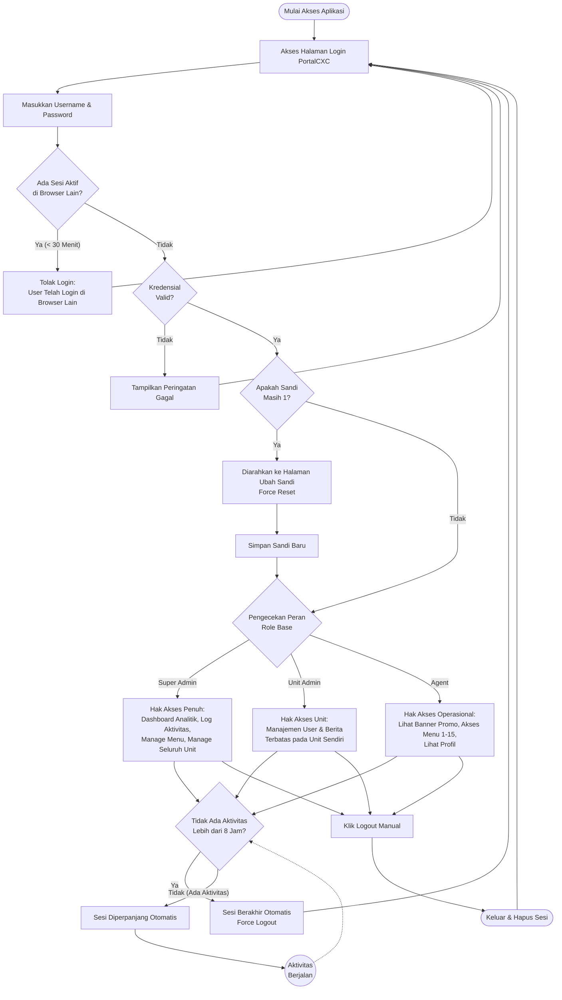

# Flow Chart PortalCXC

Salin seluruh kode Mermaid di dalam blok kode di bawah ini, lalu tempel (paste) ke editor [Mermaid.ai](https://mermaid.ai/app/projects/2c6b3170-61a6-4858-abc3-e56b91bdbd4e/diagrams/e453799f-85d9-4aba-9552-b83336f5469b/version/v0.1/edit?fromOnboarding=true) untuk menghasilkan gambar flow chart.

