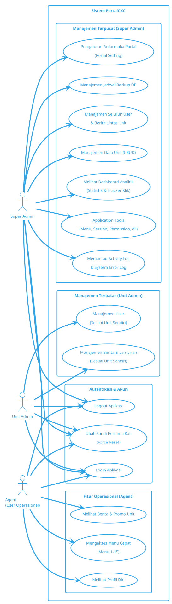

# Use Case Diagram PortalCXC

Salin seluruh kode PlantUML di dalam blok kode di bawah ini, lalu tempel (paste) ke [Editor PlantUML Web](https://www.plantuml.com/plantuml/uml/SyfFKj2rKt3CoKnELR1Io4ZDoSa700003) untuk menghasilkan gambar diagramnya.

